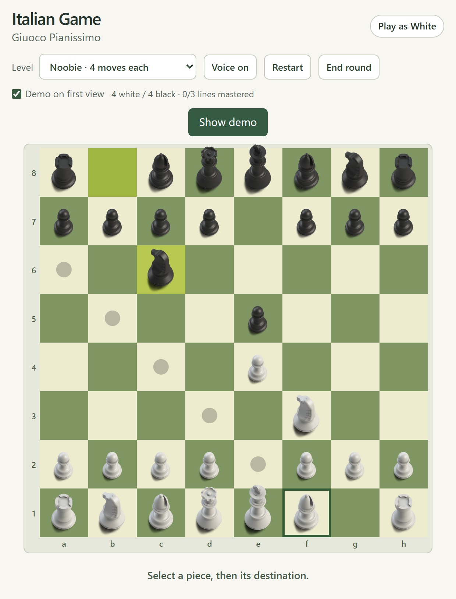

# ♟ Chess for Anki

Practice chess lines on an interactive board, with guided demonstrations, move explanations and spaced repetition in Anki. Maintained by **fernandomec**.

**[Download the free deck (.apkg)](https://github.com/fernandomec/chess-for-anki-community/raw/refs/heads/downloads/decks/Chess-for-Anki-Foundations.apkg)**

[Get the add-on](https://github.com/fernandomec/chess-for-anki-community/releases/download/v1.4.1-preview/Chess-for-Anki.ankiaddon) · [All downloads](https://github.com/fernandomec/chess-for-anki-community/releases/tag/v1.4.1-preview) · [Watch the demo](https://github.com/fernandomec/chess-for-anki-community/releases/download/v1.4.1-preview/Chess-for-Anki-English-Demo.mp4)



## Get started

1. Install the add-on in Anki through **Tools > Add-ons > Install from file**, then restart Anki.
2. Download the free `.apkg` above and import it through **File > Import**. Installing the extension itself does not create cards.
3. Open a card, step through the demonstration, then practise the line. The opponent replies automatically. Use **Again** or **Repeat later** when you need another attempt.

The **Foundations** deck has 30 cards covering simple opening plans, Scholar's Mate and its defence, basic mates and promotion. The [earlier 60-card starter deck](decks/Chess-for-Anki-Starter.apkg) is also free. Some lines are practised from both sides, so card counts include paired perspectives.

[Read the training guide](TRAINING-GUIDE.md) for levels, demonstrations, grading and creating cards from PGN or a custom position.

## Voices and languages

The add-on uses an available device voice by default. The optional [English Michael voice pack](https://github.com/fernandomec/chess-for-anki-community/releases/download/v1.4.1-preview/English-Michael-Voice-Pack.zip) adds recorded narration and explanations for the free collections. Import it from the add-on's language pack screen. Playback speed is adjustable.

Other natural voice packs are not yet available. Portuguese, Russian, Chinese, Spanish and Hindi are priorities. Hindi still needs runtime support.

[Contribute a translation or voice](CONTRIBUTING-LANGUAGES.md) · [Join the language discussion](https://github.com/fernandomec/chess-for-anki-community/discussions/1)

## Feedback

[Report a bug](https://github.com/fernandomec/chess-for-anki-community/issues/new?template=bug_report.yml) with a description and screenshot. Reports are public; remove personal details before posting. You can read replies and images directly on GitHub.

## Source and compatibility

The source is in [chess_for_anki](chess_for_anki). Build the extension with Python 3:

```text
python scripts/build_addon.py
```

The output is `dist/Chess for Anki.ankiaddon`. This version was tested on Windows with Anki 26.9.4. It rehearses saved lines; a live engine does not evaluate your moves during review. Mobile compatibility has not been established.

## Support

[Support development](SUPPORT.md) through Pix, LivePix or cryptocurrency.

Licensed under [AGPL-3.0](LICENSE). Third-party notices are in [CREDITS.md](CREDITS.md).
