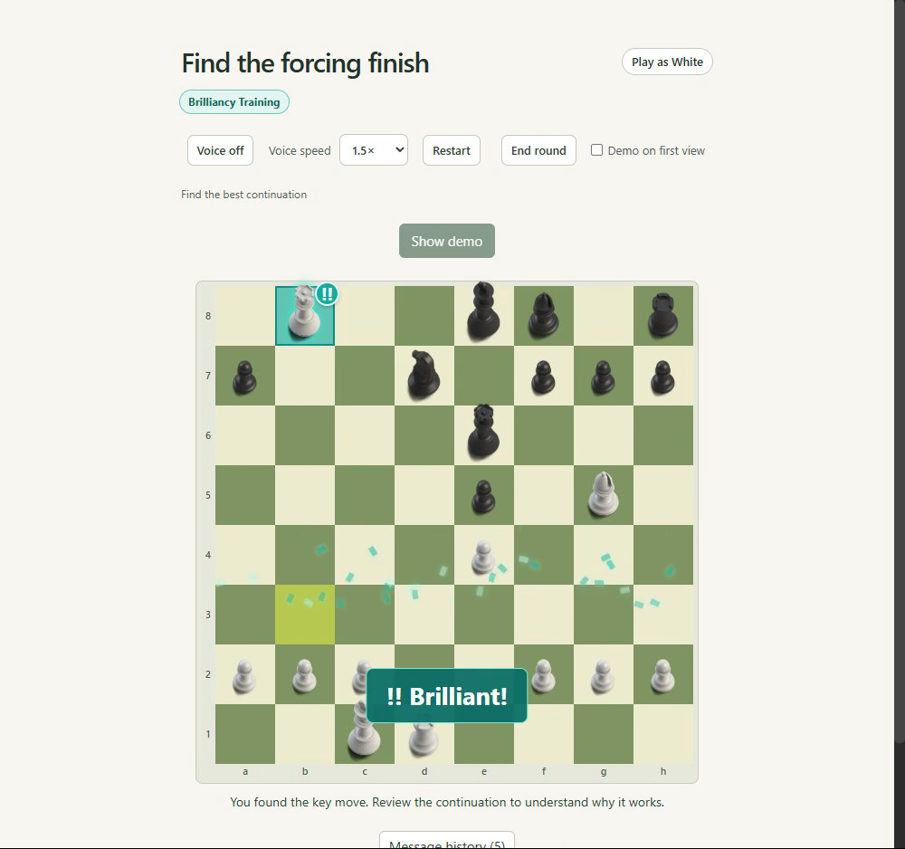

# Chess for Anki

Practise chess lines on an interactive board, with move explanations, guided demonstrations and spaced repetition in Anki. Maintained by **fernandomec**.

**Version 1.6.0 preview:** previous-move context, Brilliancy Training and a focused 22-card sample. Earlier public downloads remain available.

For this preview, install the `.ankiaddon` from the GitHub release below. The AnkiWeb add-on listing is still on the earlier 1.4.2 build while its update is pending.

**[Free sample: 22 cards (.apkg)](https://github.com/Chess-for-Anki/chess-for-anki/releases/download/v1.6.0-preview/Chess-for-Anki-Free-Sample.apkg)**

[AnkiWeb deck listing](https://ankiweb.net/shared/info/1810293290). Newly shared decks have AnkiWeb's initial 24-hour visibility delay; the GitHub download is available independently.

[Get the add-on](https://github.com/Chess-for-Anki/chess-for-anki/releases/download/v1.6.0-preview/Chess-for-Anki.ankiaddon) · [Preview release](https://github.com/Chess-for-Anki/chess-for-anki/releases/tag/v1.6.0-preview) · [Watch the demo](#demo)

## Demo

https://github.com/user-attachments/assets/0db0a2d3-e2f1-49db-8d09-c5654f50e2b5

A real Anki reviewer demonstration: opening plans, a historical combination, the previous move and optional brilliant effects. English narration, captions and piece sounds are included. Turn on sound in the player.


## Get started

1. Install the add-on through **Tools > Add-ons > Install from file**, then restart Anki.
2. Download the free sample and import it through **File > Import**. Installing the add-on creates no cards or natural voice recordings.
3. Open **Chess - Free Sample**, choose a lesson, step through the demonstration and start practice. The opponent replies from the saved line.

The sample contains:

- Five opening lessons for both sides: Italian Game, Queen's Gambit Declined, Scotch Game, London System and Sicilian Defence, giving 10 cards.
- Three Brilliancy exercises, three endgames, three middlegame decisions and three tactics.

Opening lessons reach a useful transition to middlegame plans. They are illustrative lines, not complete repertoires or forced replies. Paired perspectives count separately.

[Training guide](TRAINING-GUIDE.md) · [Commented sample PGN](decks/Chess-for-Anki-Free-Sample.pgn) · [Earlier free decks](decks/README.md)

## Practice and create

Drag a piece or click its origin and destination. **Show demo** reopens the explanation; **Restart** retries the attempt. Use **End round > Repeat later** when you need to see the answer and review again.

Curated brilliant moves can show a turquoise `!!` highlight, sound and particles. Disable these effects in Settings. They are teaching annotations, not live engine judgments.



Create your own cards from PGN or a custom position without a paid plan. New custom-position exercises need the opponent's previous move: a setup PGN fills it automatically; manual/FEN positions require a preceding FEN and move. Constructed context is labelled **Setup move**, separately from recorded history.

## Voices and community

Device speech is the default. [Natural English Michael for the free sample](https://github.com/Chess-for-Anki/chess-for-anki/releases/download/v1.6.0-preview/English-Michael-Free-Sample-1.6.zip) is an optional download covering the sample's explanations, move announcements and hints. Import the ZIP through **Chess for Anki > Language packs**, then choose playback speed in Settings. The recordings are at their original speed.

The [earlier English pack for Starter and Foundations](https://github.com/Chess-for-Anki/chess-for-anki/releases/download/v1.4.2-preview/English-Michael-Voice-Pack.zip) remains available separately. Voices are selected per profile; choose the pack matching your lessons. Unrecorded phrases can use device speech. Other natural voices are planned; Hindi still needs runtime support. [Voice-pack guide](VOICE-PACKS.md).

[Contribute a language or voice](CONTRIBUTING-LANGUAGES.md) · [Language discussion](https://github.com/Chess-for-Anki/chess-for-anki/discussions/1) · [Report a bug](https://github.com/Chess-for-Anki/chess-for-anki/issues)

Extended training packs and PRO plans are being prepared. They are not on sale and no subscription checkout is active. The free core, previously distributed material and your imported cards remain available.

## Source and compatibility

Source is in [chess_for_anki](chess_for_anki). Build with Python 3:

```text
python scripts/build_addon.py
```

The output is `dist/Chess for Anki.ankiaddon`. Windows with Anki desktop 26.9.4 is the tested platform; the preview passed isolated collection, importer and board checks. Compatibility with macOS, Linux and mobile has not been established. Review rehearses saved lines without a live analysis engine.

[Support development](SUPPORT.md) · [AGPL-3.0 license](LICENSE) · [Credits and third-party notices](CREDITS.md)
